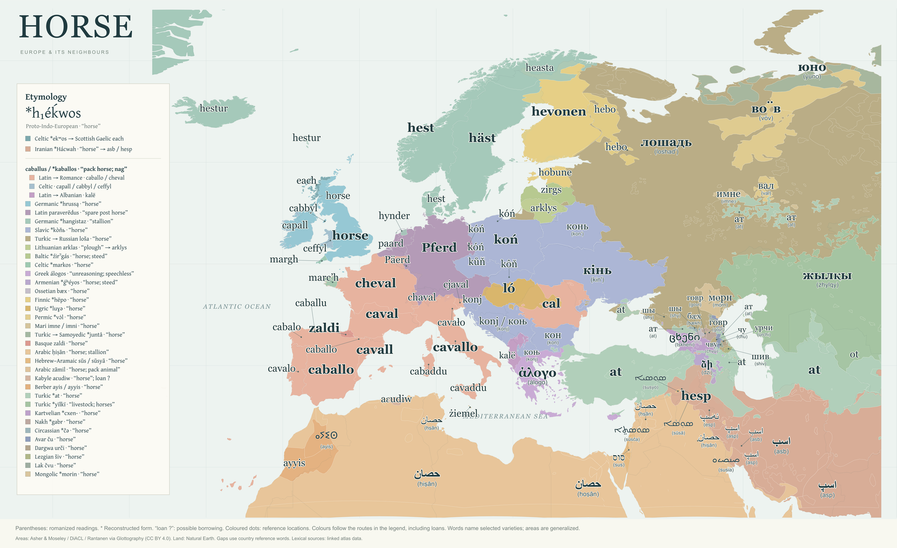

# Horse — A Word Map

[Live map](https://khayoon.github.io/horse-word-atlas/) · [Sources](https://khayoon.github.io/horse-word-atlas/#sources) · [6,000px PNG](dist/downloads/horse-map-landscape-6000px.png) · [SVG](dist/downloads/horse-map-landscape.svg) · [Snow version](https://khayoon.github.io/snow-word-atlas/)

A flat landscape linguistic map of words for **horse** across Europe and its neighbours: **105 selected language/variety entries** and **34 word-origin sets**. It reuses the snow atlas’s language geography, compact Gentium Plus legend and high-resolution export layout.

## Reading the map

- The PIE horse noun *h₁éḱwos heads two separate colour rows: Scottish Gaelic each via Proto-Celtic *ekʷos, and Iranian *Hácwah → asb/asp/hesp. They share an earlier ancestor but follow separate branches. These are the two lineages represented by the selected labels, not the only surviving descendants: Greek ίππος also continues that noun, while this map selects everyday άλογο. Other colours follow word ancestry, including borrowings; uncertain deep links remain separate.
- The caballus / *kaballos family has a shared heading and three separate route colours: Romance, Celtic and Albanian. Romance words continue Latin caballus; Albanian kalë is a Latin loan. The related Celtic terms retain their individual histories and disputed early borrowing directions in the entry notes.
- The same generalized, overlapping language footprints as the snow atlas are retained. A complete Natural Earth country reference layer fills the land beneath them; this is not a census or a claim of exclusive language use. Kurdish supplements retain their published 1750 reference epoch.
- Romanizations under non-Latin words are reading aids, not IPA. Maaloula shows ܣܘܣܬ̤ܐ with (sūsča), an editorial Syriac rendering of Arnold’s attested transcription using the documented ܬ̤ = č convention. This is a script choice, not a directly quoted native spelling or a universal Maaloula standard; Mandaic susia is a literary/liturgical reference near Basra. Points indicate reference locations where suitable polygons were not verified.
- No reliable indigenous Canarian horse term was verified. The earlier snow word tener? is not reused: this version retains the modern Spanish reference on the islands.
- Northern Luri asp is supported by a local speaker comparison rather than a critical dictionary. The Iraqi Arabic reading ḥiṣān also appears in a Baghdadi Arabic plant-name study; regional vowels vary. Entry notes retain these source limitations.
- Common representative nouns are selected. Russian лошадь is used alongside neighbouring Slavic konj/koń forms; Russian конь remains a noted alternative. Irish capall and Scottish Gaelic each intentionally illustrate different histories.
- Colour groups follow the ancestry and routes shown in the legend, including loans; shared colour is not proof of direct inheritance. The PIE horse noun has separate Scottish Gaelic and Iranian route colours; *ekʷos is the reconstructed Proto-Celtic ancestor of Gaelic each. English horse, German Pferd, Scandinavian hest and Romance caballo/cheval are separate sets. An asterisk marks a reconstructed form; “loan ?” marks a possible borrowing. Other unresolved histories are explained in the entry notes.
- The caballus/*kaballos group has separate Romance, Celtic and Albanian route colours without making every Celtic word a direct Latin loan. Finnic and Caucasian proposed Indo-European links remain unresolved. Some origin sets stop at an attested local word.
- The Syriac, Mandaic and Tifinagh labels and the full legend are shaped to vector outlines for reliable PNG/SVG export. Other words remain editable SVG text. Non-Latin words retain parenthesized romanized readings.

## Run and export

With Node.js installed, run `node local-server.mjs`, or double-click `Open Horse Atlas.cmd` on Windows. Open the loopback URL printed in the terminal. All runtime assets are bundled; linked references require internet access.

Export PNG at 6,000, 9,000 or 12,000 pixels wide or save SVG. Default composition: 1800 × 1100; the 6,000px download is 6000 × 3667. Controls and dialogs are excluded from the artwork.

## Data

- `dist/data/lexicon.json`: selected nouns, romanizations, origin sets, schematic chains, references and uncertainty notes.
- `dist/data/territories.geojson`: 180 generalized geometry features with provenance. The historical La Palma reference fill from the snow map is omitted.
- `dist/data/land-reference.geojson`: complete country-reference layer below the language footprints.
- `dist/data/geometry-sources.json` and `map-coverage.json`: source epochs, geography and inherited continuous-coverage method. Geography comes from the attributed snow-atlas build; it is not new fieldwork.
- `dist/data/source-catalog.json`: complete linked source list.
- `dist/vendor/`: D3, Gentium Plus and Noto fonts, vector typography and licenses.

## GitHub Pages

The workflow in `.github/workflows/pages.yml` deploys `dist/` when `main` changes. Relative paths support the `/horse-word-atlas/` project URL. No server, API key or sign-in is required on GitHub Pages.

## Sources

### Geography

- **Asher, R. E. & Christopher J. Moseley (eds.) 2007. Atlas of the World's Languages. 2nd edn. Routledge.** — Contemporary speaker-area polygons; source atlas published in 2007, digitized dataset version 2.0. [Dataset repository](https://github.com/Glottography/asher2007world) · [Dataset DOI](https://doi.org/10.5281/zenodo.18613195) · [Exact source GeoJSON](https://raw.githubusercontent.com/Glottography/asher2007world/5590fcc8870d8883a323ff0defd5a1a6a03e9611/cldf/contemporary/features.geojson)
- **Carling, Gerd & Jost Gippert (eds.) 2025. DiACL/TITUS Polygon Archive. Frankfurt am Main: Goethe University.** — Traditional areas for Catalan, Occitan, Cornish, Crimean Tatar, Northern Kurdish and Central Kurdish; reference year 1750, with source timeframes usually 1750–2000. [Dataset repository](https://github.com/Glottography/carling2025diacl) · [Primary resource](https://diacl.uni-frankfurt.de/GeographicalPresence/Index) · [Derived dataset DOI](https://doi.org/10.5281/zenodo.18614010)
- **Rantanen, T., Vesakoski, O., Ylikoski, J., & Tolvanen, H. (2021). Geographical database of the Uralic languages (v1.0). Zenodo.** — Traditional Northern Sámi and Veps areas, approximately the widest known at the beginning of the 20th century. [Dataset repository](https://github.com/Glottography/rantanen2021uralic) · [Original dataset DOI](https://doi.org/10.5281/zenodo.4784188) · [Derived dataset DOI](https://doi.org/10.5281/zenodo.18643660) · [Methods paper](https://doi.org/10.1371/journal.pone.0269648)
- **Natural Earth 1:50m Admin 0 – Countries** — Complete reference-language land fill underneath language polygons; country boundaries are not linguistic boundaries. [Source download](https://www.naturalearthdata.com/downloads/50m-cultural-vectors/50m-admin-0-countries-2/) · [Terms of use](https://www.naturalearthdata.com/about/terms-of-use/)
- **Glottolog 5.3: language reference locations** — Reference points for Maaloula Western Neo-Aramaic and Assyrian Neo-Aramaic; locations do not define speaker-area boundaries. [Western Neo-Aramaic](https://glottolog.org/resource/languoid/id/west2763) · [Assyrian Neo-Aramaic](https://glottolog.org/resource/languoid/id/assy1241)

### Lexical and historical references

All 128 references

- [Wiktionary: Reconstruction:Proto-Indo-European/h₁éḱwos](https://en.wiktionary.org/wiki/Reconstruction%3AProto-Indo-European%2Fh%E2%82%81%C3%A9%E1%B8%B1wos) — PIE horse word.
- [Encyclopaedia Iranica: ASB i., Iranian horse terminology](https://www.iranicaonline.org/articles/asb-pre-islamic-iran/) — PIE horse word.
- [Wiktionary: Scottish Gaelic each, via Old Irish ech and Proto-Celtic *ekʷos](https://en.wiktionary.org/wiki/each#Scottish_Gaelic) — Scottish Gaelic; PIE horse word.
- [Wiktionary: Greek ίππος, another surviving PIE horse-word reflex](https://en.wiktionary.org/wiki/%CE%AF%CF%80%CF%80%CE%BF%CF%82#Greek) — PIE horse word.
- [Wiktionary: Latin equus, inherited PIE horse noun](https://en.wiktionary.org/wiki/equus#Latin) — PIE horse word.
- [Wiktionary: caballus](https://en.wiktionary.org/wiki/caballus) — Sardinian; Caballus word-family.
- [Wiktionary: capall (Irish)](https://en.wiktionary.org/wiki/capall#Irish) — Irish; Caballus word-family.
- [Wiktionary: ceffyl (Welsh)](https://en.wiktionary.org/wiki/ceffyl#Welsh) — Welsh; Caballus word-family.
- [Lewis & Short, A Latin Dictionary: caballus](https://www.perseus.tufts.edu/hopper/text?doc=Perseus:text:1999.04.0059:entry=caballus) — Caballus word-family.
- [Wiktionary: Reconstruction:Proto-Germanic/hrussą](https://en.wiktionary.org/wiki/Reconstruction%3AProto-Germanic%2Fhruss%C4%85) — Germanic.
- [Wiktionary: horse (English)](https://en.wiktionary.org/wiki/horse#English) — English; Syrian Arabic; Uzbek; Germanic.
- [Wiktionary: paraveredus](https://en.wiktionary.org/wiki/paraveredus) — Late Latin.
- [Wiktionary: Pferd (German)](https://en.wiktionary.org/wiki/Pferd#German) — German; Late Latin.
- [Wiktionary: paard (Dutch)](https://en.wiktionary.org/wiki/paard#Dutch) — Dutch; Late Latin.
- [Wiktionary: Reconstruction:Proto-Germanic/hangistaz](https://en.wiktionary.org/wiki/Reconstruction%3AProto-Germanic%2Fhangistaz) — Germanic.
- [Wiktionary: hynder (West Frisian)](https://en.wiktionary.org/wiki/hynder#West_Frisian) — West Frisian; Germanic.
- [Wiktionary: hiisti (Greenlandic)](https://en.wiktionary.org/wiki/hiisti#Greenlandic) — Greenlandic; Germanic.
- [Matsumoto Ryo, Horse in Uralic, Linguistic Atlas of Asia and Africa, p.147](https://geolinguistics.sakura.ne.jp/Monograph/SiG-mono3-LAAA-1-ebook.pdf) — Northern Sámi; Germanic; Mari; Turkic → Samoyedic.
- [Wiktionary: Reconstruction:Proto-Slavic/koňь](https://en.wiktionary.org/wiki/Reconstruction%3AProto-Slavic%2Fko%C5%88%D1%8C) — Slavic.
- [Wiktionary: konj (Serbo-Croatian)](https://en.wiktionary.org/wiki/konj#Serbo-Croatian) — Serbian–Croatian–Bosnian; Slavic.
- [Wiktionary: кінь (Ukrainian)](https://en.wiktionary.org/wiki/%D0%BA%D1%96%D0%BD%D1%8C#Ukrainian) — Ukrainian; Slavic.
- [Wiktionary: лошадь (Russian)](https://en.wiktionary.org/wiki/%D0%BB%D0%BE%D1%88%D0%B0%D0%B4%D1%8C#Russian) — Russian; Turkic → Russian.
- [Wiktionary: arklys (Lithuanian)](https://en.wiktionary.org/wiki/arklys#Lithuanian) — Lithuanian; Lithuanian.
- [Wiktionary: zirgs (Latvian)](https://en.wiktionary.org/wiki/zirgs#Latvian) — Latvian; Baltic.
- [Wiktionary: Reconstruction:Proto-Celtic/markos](https://en.wiktionary.org/wiki/Reconstruction%3AProto-Celtic%2Fmarkos) — Celtic.
- [Wiktionary: άλογο (Greek)](https://en.wiktionary.org/wiki/%CE%AC%CE%BB%CE%BF%CE%B3%CE%BF#Greek) — Greek; Greek.
- [Wiktionary: ձի (Old Armenian)](https://en.wiktionary.org/wiki/%D5%B1%D5%AB#Old_Armenian) — Armenian.
- [Wiktionary: Reconstruction:Proto-Indo-European/ǵʰéyos](https://en.wiktionary.org/wiki/Reconstruction%3AProto-Indo-European%2F%C7%B5%CA%B0%C3%A9yos) — Armenian.
- [Wiktionary: бӕх (Ossetian)](https://en.wiktionary.org/wiki/%D0%B1%D3%95%D1%85#Ossetian) — Ossetian; Ossetian.
- [Wiktionary: Reconstruction:Proto-Finnic/hëpo](https://en.wiktionary.org/wiki/Reconstruction%3AProto-Finnic%2Fh%C3%ABpo) — Finnic.
- [Wiktionary: hevonen (Finnish)](https://en.wiktionary.org/wiki/hevonen#Finnish) — Finnish; Finnic.
- [Wiktionary: ló (Hungarian)](https://en.wiktionary.org/wiki/l%C3%B3#Hungarian) — Hungarian; Ugric.
- [Wiktionary: Reconstruction:Proto-Ugric/luɣǝ](https://en.wiktionary.org/wiki/Reconstruction%3AProto-Ugric%2Flu%C9%A3%C7%9D) — Ugric.
- [Wiktionary: вал (Udmurt)](https://en.wiktionary.org/wiki/%D0%B2%D0%B0%D0%BB#Udmurt) — Udmurt; Permic.
- [Wiktionary: вӧв (Komi-Zyrian)](https://en.wiktionary.org/wiki/%D0%B2%D3%A7%D0%B2#Komi-Zyrian) — Komi-Zyrian; Permic.
- [Wiktionary: имне (Eastern Mari)](https://en.wiktionary.org/wiki/%D0%B8%D0%BC%D0%BD%D0%B5#Eastern_Mari) — Meadow Mari; Mari.
- [COPIUS, Samoyedic historical phonology: *juntå → Tundra Nenets juna/juno](https://copius.univie.ac.at/etymology/slides_13_samo.pdf) — Tundra Nenets; Turkic → Samoyedic.
- [Wiktionary: zaldi (Basque)](https://en.wiktionary.org/wiki/zaldi#Basque) — Basque; Basque.
- [Wiktionary: حصان (Arabic)](https://en.wiktionary.org/wiki/%D8%AD%D8%B5%D8%A7%D9%86#Arabic) — Arabic (standard reference); Mesopotamian Arabic; Arabic.
- [Wiktionary: סוס (Hebrew)](https://en.wiktionary.org/wiki/%D7%A1%D7%95%D7%A1#Hebrew) — Hebrew; Hebrew & Aramaic.
- [Wiktionary: ܣܘܣܝܐ (Classical Syriac)](https://en.wiktionary.org/wiki/%DC%A3%DC%98%DC%A3%DC%9D%DC%90#Classical_Syriac) — Hebrew & Aramaic.
- [Comprehensive Aramaic Lexicon, swsy horse](https://cal.huc.edu/oneentry.php?lemma=swsy%20N&cits=all) — Hebrew & Aramaic.
- [Wiktionary: żiemel (Maltese)](https://en.wiktionary.org/wiki/%C5%BCiemel#Maltese) — Maltese; Arabic → Maltese.
- [Centre de Recherche Berbère, Aures: comparison of Chaoui yis and Kabyle aɛudiw](https://centrederechercheberbere.fr/aures.html) — Kabyle; Kabyle.
- [Amawal, Kabyle dictionary: aɛawdiw / aɛudiw](https://amawal.numidya.net/amawal/a/Goi4tKpe/a%C9%9Bawdiw) — Kabyle; Kabyle.
- [Wiktionary: ⴰⵢⵉⵙ (Central Atlas Tamazight)](https://en.wiktionary.org/wiki/%E2%B4%B0%E2%B5%A2%E2%B5%89%E2%B5%99#Central_Atlas_Tamazight) — Central Atlas Tamazight; Berber.
- [Wiktionary: ayyis (Tashelhit)](https://en.wiktionary.org/wiki/ayyis#Tashelhit) — Tachelhit; Berber.
- [Tamazight–English Dictionary, horse: ayyis](https://www.temehu.com/imazighen/dictionaries/Amawals/tamazight-english-dictionary-acf.pdf) — Berber.
- [Wiktionary: Reconstruction:Proto-Turkic/at](https://en.wiktionary.org/wiki/Reconstruction%3AProto-Turkic%2Fat) — Uzbek; Turkic.
- [Wiktionary: at (Turkish)](https://en.wiktionary.org/wiki/at#Turkish) — Turkish; Turkic.
- [Wiktionary: жылқы (Kazakh)](https://en.wiktionary.org/wiki/%D0%B6%D1%8B%D0%BB%D2%9B%D1%8B#Kazakh) — Kazakh; Turkic.
- [Wiktionary: ცხენი (Georgian)](https://en.wiktionary.org/wiki/%E1%83%AA%E1%83%AE%E1%83%94%E1%83%9C%E1%83%98#Georgian) — Georgian; Kartvelian.
- [Wiktionary: говр (Chechen)](https://en.wiktionary.org/wiki/%D0%B3%D0%BE%D0%B2%D1%80#Chechen) — Chechen; Nakh.
- [Wiktionary: говр (Ingush)](https://en.wiktionary.org/wiki/%D0%B3%D0%BE%D0%B2%D1%80#Ingush) — Ingush; Nakh.
- [Wiktionary: шы (East Circassian)](https://en.wiktionary.org/wiki/%D1%88%D1%8B#East_Circassian) — Kabardian; Circassian.
- [Wiktionary: шы (West Circassian)](https://en.wiktionary.org/wiki/%D1%88%D1%8B#West_Circassian) — Adyghe; Circassian.
- [Wiktionary: чу (Avar)](https://en.wiktionary.org/wiki/%D1%87%D1%83#Avar) — Avar; Avar.
- [Wiktionary: урчи (Dargwa)](https://en.wiktionary.org/wiki/%D1%83%D1%80%D1%87%D0%B8#Dargwa) — Dargwa; Dargwa.
- [Wiktionary: шив (Lezgi)](https://en.wiktionary.org/wiki/%D1%88%D0%B8%D0%B2#Lezgi) — Lezgian; Lezgian.
- [Wiktionary: чву (Lak)](https://en.wiktionary.org/wiki/%D1%87%D0%B2%D1%83#Lak) — Lak; Lak.
- [Wiktionary: мөрн (Kalmyk)](https://en.wiktionary.org/wiki/%D0%BC%D3%A9%D1%80%D0%BD#Kalmyk) — Kalmyk; Mongolic.
- [Wiktionary: horse (Scots)](https://en.wiktionary.org/wiki/horse#Scots) — Scots.
- [Wiktionary: Päerd (Luxembourgish)](https://en.wiktionary.org/wiki/P%C3%A4erd#Luxembourgish) — Luxembourgish.
- [Wiktionary: hest (Danish)](https://en.wiktionary.org/wiki/hest#Danish) — Danish.
- [Wiktionary: häst (Swedish)](https://en.wiktionary.org/wiki/h%C3%A4st#Swedish) — Swedish.
- [Wiktionary: hest (Norwegian Bokmål)](https://en.wiktionary.org/wiki/hest#Norwegian_Bokmål) — Norwegian.
- [Wiktionary: hestur (Icelandic)](https://en.wiktionary.org/wiki/hestur#Icelandic) — Icelandic.
- [Wiktionary: hestur (Faroese)](https://en.wiktionary.org/wiki/hestur#Faroese) — Faroese.
- [Wiktionary: caballo (Spanish)](https://en.wiktionary.org/wiki/caballo#Spanish) — Spanish.
- [Wiktionary: cavalo (Portuguese)](https://en.wiktionary.org/wiki/cavalo#Portuguese) — Portuguese.
- [Wiktionary: cabalo (Galician)](https://en.wiktionary.org/wiki/cabalo#Galician) — Galician.
- [Wiktionary: cavall (Catalan)](https://en.wiktionary.org/wiki/cavall#Catalan) — Catalan.
- [Wiktionary: caval (Occitan)](https://en.wiktionary.org/wiki/caval#Occitan) — Occitan.
- [Wiktionary: cavallo (Italian)](https://en.wiktionary.org/wiki/cavallo#Italian) — Italian.
- [Wiktionary: cavaddu (Sicilian)](https://en.wiktionary.org/wiki/cavaddu#Sicilian) — Sicilian.
- [Wiktionary: cavało (Venetan)](https://en.wiktionary.org/wiki/cava%C5%82o#Venetan) — Venetian.
- [Wiktionary: cjaval (Friulian)](https://en.wiktionary.org/wiki/cjaval#Friulian) — Friulian.
- [Wiktionary: chaval (Romansh)](https://en.wiktionary.org/wiki/chaval#Romansh) — Romansh.
- [Wiktionary: caballu (Asturian)](https://en.wiktionary.org/wiki/caballu#Asturian) — Asturian.
- [Wiktionary: caballo (Aragonese)](https://en.wiktionary.org/wiki/caballo#Aragonese) — Aragonese.
- [Wiktionary: cheval (French)](https://en.wiktionary.org/wiki/cheval#French) — French.
- [Wiktionary: cal (Romanian)](https://en.wiktionary.org/wiki/cal#Romanian) — Romanian.
- [Wiktionary: конь (Belarusian)](https://en.wiktionary.org/wiki/%D0%BA%D0%BE%D0%BD%D1%8C#Belarusian) — Belarusian.
- [Wiktionary: koń (Polish)](https://en.wiktionary.org/wiki/ko%C5%84#Polish) — Polish.
- [Wiktionary: kůň (Czech)](https://en.wiktionary.org/wiki/k%C5%AF%C5%88#Czech) — Czech.
- [Wiktionary: kôň (Slovak)](https://en.wiktionary.org/wiki/k%C3%B4%C5%88#Slovak) — Slovak.
- [Wiktionary: konj (Slovene)](https://en.wiktionary.org/wiki/konj#Slovene) — Slovenian.
- [Wiktionary: кон (Bulgarian)](https://en.wiktionary.org/wiki/%D0%BA%D0%BE%D0%BD#Bulgarian) — Bulgarian.
- [Wiktionary: коњ (Macedonian)](https://en.wiktionary.org/wiki/%D0%BA%D0%BE%D1%9A#Macedonian) — Macedonian.
- [Wiktionary: kóń (Upper Sorbian)](https://en.wiktionary.org/wiki/k%C3%B3%C5%84#Upper_Sorbian) — Upper Sorbian.
- [Wiktionary: kóń (Lower Sorbian)](https://en.wiktionary.org/wiki/k%C3%B3%C5%84#Lower_Sorbian) — Lower Sorbian.
- [Wiktionary: kóń (Kashubian)](https://en.wiktionary.org/wiki/k%C3%B3%C5%84#Kashubian) — Kashubian.
- [Wiktionary: cabbyl (Manx)](https://en.wiktionary.org/wiki/cabbyl#Manx) — Manx.
- [Wiktionary: marc’h (Breton)](https://en.wiktionary.org/wiki/marc%27h#Breton) — Breton.
- [Wiktionary: margh (Cornish)](https://en.wiktionary.org/wiki/margh#Cornish) — Cornish.
- [Wiktionary: ձի (Armenian)](https://en.wiktionary.org/wiki/%D5%B1%D5%AB#Armenian) — Armenian.
- [Wiktionary: kalë (Albanian)](https://en.wiktionary.org/wiki/kal%C3%AB#Albanian) — Albanian.
- [Wiktionary: اسب (Persian)](https://en.wiktionary.org/wiki/%D8%A7%D8%B3%D8%A8#Persian) — Persian.
- [Wiktionary: hesp (Northern Kurdish)](https://en.wiktionary.org/wiki/hesp#Northern_Kurdish) — Northern Kurdish.
- [Wiktionary: hobune (Estonian)](https://en.wiktionary.org/wiki/hobune#Estonian) — Estonian.
- [Wiktionary: hebo (Karelian)](https://en.wiktionary.org/wiki/hebo#Karelian) — Karelian.
- [Wiktionary: hebo (Veps)](https://en.wiktionary.org/wiki/hebo#Veps) — Veps.
- [Wiktionary: حصان (Tunisian Arabic)](https://en.wiktionary.org/wiki/%D8%AD%D8%B5%D8%A7%D9%86#Tunisian_Arabic) — Tunisian Arabic.
- [Wiktionary: حصان (Egyptian Arabic)](https://en.wiktionary.org/wiki/%D8%AD%D8%B5%D8%A7%D9%86#Egyptian_Arabic) — Egyptian Arabic.
- [AIDA16 Booklet of Abstracts (2026), Baghdadi Arabic plant names: il-ḥiṣān in horse-tail, p.60](https://aidacatania.unict.it/AIDA16_Booklet_of_Abstracts_09_06_2026_DEF.pdf) — Mesopotamian Arabic.
- [Wiktionary: at (Azerbaijani)](https://en.wiktionary.org/wiki/at#Azerbaijani) — Azerbaijani.
- [Wiktionary: ат (Tatar)](https://en.wiktionary.org/wiki/%D0%B0%D1%82#Tatar) — Tatar.
- [Wiktionary: ат (Bashkir)](https://en.wiktionary.org/wiki/%D0%B0%D1%82#Bashkir) — Bashkir.
- [Wiktionary: at (Crimean Tatar)](https://en.wiktionary.org/wiki/at#Crimean_Tatar) — Crimean Tatar.
- [Wiktionary: ат (Kyrgyz)](https://en.wiktionary.org/wiki/%D0%B0%D1%82#Kyrgyz) — Kyrgyz.
- [Wiktionary: at (Turkmen)](https://en.wiktionary.org/wiki/at#Turkmen) — Turkmen.
- [Wiktionary (Russian), ат: Karachay-Balkar horse noun](https://ru.wiktionary.org/wiki/%D0%B0%D1%82#%D0%9A%D0%B0%D1%80%D0%B0%D1%87%D0%B0%D0%B5%D0%B2%D0%BE-%D0%B1%D0%B0%D0%BB%D0%BA%D0%B0%D1%80%D1%81%D0%BA%D0%B8%D0%B9) — Karachay-Balkar.
- [Ethnocultural study of ат, horse, in Karachay-Balkar phraseology](https://www.elbrusoid.net/articles/poznat/393388/) — Karachay-Balkar.
- [Wiktionary: ат (Kumyk)](https://en.wiktionary.org/wiki/%D0%B0%D1%82#Kumyk) — Kumyk.
- [Wiktionary: اسپ (Baluchi)](https://en.wiktionary.org/wiki/%D8%A7%D8%B3%D9%BE#Baluchi) — Balochi.
- [Northern Luri/Feyli speaker word comparison: اسپ = horse](https://lori-shomali.blogfa.com/post/36) — Northern Luri.
- [Wiktionary: 𐎠𐎿𐎱 (Old Persian)](https://en.wiktionary.org/wiki/%F0%90%8E%A0%F0%90%8E%BF%F0%90%8E%B1#Old_Persian) — Southern Luri.
- [Vajehyab, Bakhtiari dictionary: اسب /asb/](https://vajehyab.com/bakhtiari/%D8%A7%D8%B3%D8%A8) — Bakhtiari.
- [Wiktionary: ئەسپ (Central Kurdish)](https://en.wiktionary.org/wiki/%D8%A6%DB%95%D8%B3%D9%BE#Central_Kurdish) — Central Kurdish.
- [Werner Arnold (2025), Animals in the Western Neo-Aramaic Proverbs of Maʿlūla, appendix: horse (sūsča)](https://books.openbookpublishers.com/10.11647/obp.0464.31.pdf) — Western Neo-Aramaic (Maaloula).
- [Western Neo-Aramaic writing systems: Syriac alphabet and ܬ̤ / č correspondence](https://en.wikipedia.org/wiki/Western_Neo-Aramaic#Syriac_and_Arabic_alphabet) — Western Neo-Aramaic (Maaloula).
- [Wiktionary: Western Neo-Aramaic ܒܪܬ̤ܐ (berča), parallel use of ܬ̤ for č](https://en.wiktionary.org/wiki/%DC%92%DC%AA%DC%AC%CC%A4%DC%90) — Western Neo-Aramaic (Maaloula).
- [Ma’luli New Testament (2018), Syriac and Arabic scripts; Revelation 6:2, printed p. 1274 (PDF p. 1282)](https://scriptureearth.org/data/amw/PDF/amwMaLuliNT-web.pdf#page=1282) — Western Neo-Aramaic (Maaloula).
- [Wiktionary: ܣܘܣܐ (Assyrian Neo-Aramaic)](https://en.wiktionary.org/wiki/%DC%A3%DC%98%DC%A3%DC%90#Assyrian_Neo-Aramaic) — Assyrian Neo-Aramaic.
- [Barsky, Kalinin & Loesov (2018), The Basic Lexicon of Mlaḥsô: A Comparative Study, p.228, Turoyo susyo](https://www.ub.edu/ipoa/wp-content/uploads/2021/07/20182AuOrBarsky.pdf) — Turoyo / Surayt.
- [Sfar Mele, Turoyo learning vocabulary: Horse (Pferd), Susyo](https://sfarmele.de/?page=lernen) — Turoyo / Surayt.
- [Qais Al-Saadi (2012), Nhura dictionary, printed p.91: Horse [susia]](https://qadaha.wordpress.com/wp-content/uploads/2021/03/nhura-dictionary-mandaic-english-mandaic.pdf#page=92) — Mandaic (Mandaean liturgical reference).
- [Glosbe, Mandaic Professional entry: ࡎࡅࡎࡉࡀ](https://glosbe.com/en/mid/horse) — Mandaic (Mandaean liturgical reference).

### Typography, software and attribution

- [Gentium Plus Regular and Bold](https://github.com/google/fonts/tree/main/ofl/gentiumplus) — SIL Open Font License 1.1.
- [D3 7.9.0](https://d3js.org) — ISC.
- [SIL International](http://www.sil.org/) — Copyright holder named in GentiumPlus-OFL.txt, copyright 2003–2022 SIL International..
- [Noto Sans Syriac, Noto Sans Mandaic and Noto Sans Tifinagh](https://github.com/notofonts/noto-fonts) — SIL Open Font License 1.1.

Wiktionary material is identified as CC BY-SA 4.0. Geography attributed by Glottography is CC BY 4.0; Natural Earth is public domain. Dictionaries, fieldwork and other publications retain their own terms. Original explanatory summaries and brief lexical facts are attributed individually. D3 and font notices remain in `dist/vendor/`. No blanket license is asserted over mixed third-party data.
